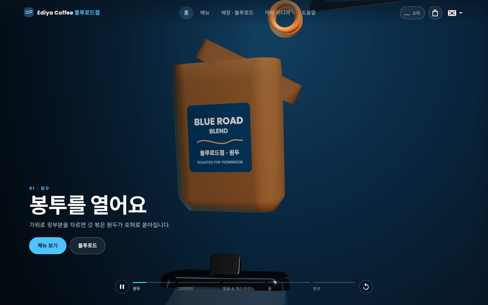
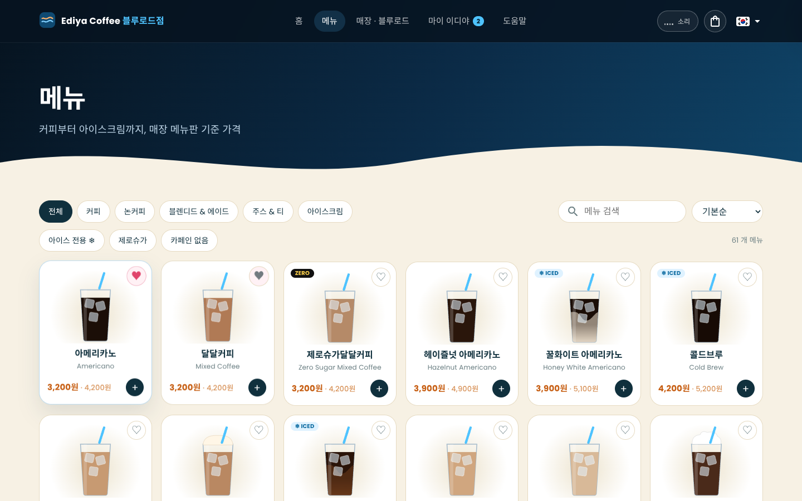
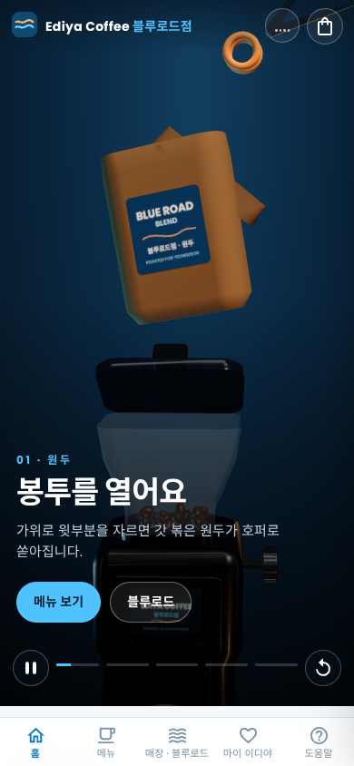
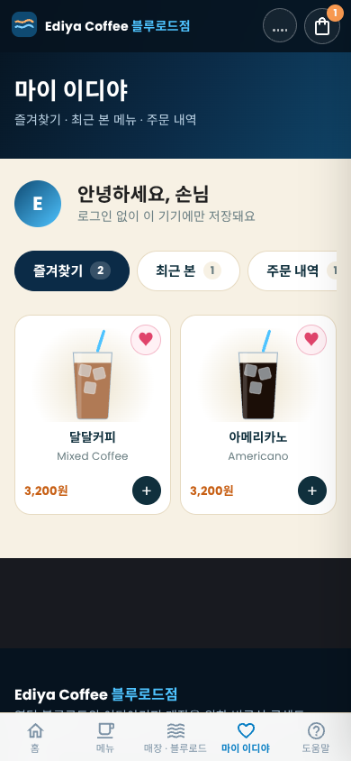

<div align="center">

# Ediya BlueRoad (이디야 블루로드)

**한국어가 서툰 손님이 카운터에서 주문할 수 있게 돕는 카페 웹사이트. 홈에는 실시간 3D로 음료가 만들어지는 과정을 보여줍니다.**

[라이브 데모](https://YOUR-VERCEL-URL.vercel.app) · [English](./README.md)




</div>

> **비공식 콘셉트 프로젝트.** 영덕 이디야커피 매장의 바리스타가 포트폴리오로 만들었습니다. 이디야커피 공식 사이트가 아니며 주문·결제 기능은 없습니다.

## 문제
작은 해안 도시를 찾은 방문객은 한국어가 서툰 경우가 많습니다. 카운터 앞에서 먹고 싶은 건 정해도 어떻게 말해야 할지 몰라 막히고, 메뉴판만으로는 도움이 되지 않습니다.

## 해결
휴대폰으로 실제 메뉴를 보고 장바구니에 담으면, 카운터에서 읽거나 보여줄 수 있는 문장으로 바뀝니다.

> **아이스 아메리카노 라지 2잔 주문할게요.**

홈 화면은 한 잔이 만들어지는 과정(봉투 → 그라인더 → 얼음 → 에스프레소 → 물 → 완성)을 저절로 재생되는 3D 애니메이션으로 보여주고, 원하면 소리도 켤 수 있습니다.

## 스크린샷

| 메뉴 (데스크톱) | 홈 (모바일) | 마이 이디야 (모바일) |
|---|---|---|
|  |  |  |

## 기능
- **자동 재생 3D 히어로**(three.js): 봉투와 가위, 실시간 도징 화면이 달린 그라인더, 얼음·에스프레소·물, 반투명 로고가 새겨진 잔까지. 일시정지·다시 보기·5개 단계 칩 제공, 스크롤 불필요.
- **히어로 영상(선택)**: 생성한 영상을 넣으면 3D 장면 대신 재생되고, 영상이 없으면 3D 애니메이션이 대신합니다([히어로 영상 사용하기](#히어로-영상-사용하기)).
- **소리**: WebAudio로 만든 파도·카페 분위기와 애니메이션에 맞춰 나는 그라인더·물·잔 소리. 버튼을 누르기 전에는 무음.
- **메뉴**: 61개 음료, 카테고리, 필터(아이스 전용·제로슈가·카페인 없음), 정렬, 검색.
- **메뉴 상세**: 드래그로 돌려보는 3D 잔, 사이즈·온도·옵션, 맛 그래프, 함께 보면 좋은 메뉴.
- **장바구니 → 주문 문구**: 카운터용 한국어 문장 복사.
- **마이 이디야**: 즐겨찾기, 최근 본 메뉴, 주문 내역, 닉네임. 계정 없이 브라우저에만 저장.
- **도움말**, SVG 코스 지도가 있는 **매장 · 블루로드** 페이지, 맞춤 404.
- **한국어(기본)·English·Русский**, 데스크톱/모바일 별도 레이아웃(휴대폰은 하단 탭바).

## 기술 스택
| 영역 | 선택 |
|---|---|
| 프레임워크 | Next.js 14 (Pages Router), React 18, TypeScript 5 |
| UI | MUI 5 + SCSS (브랜드 스타일 한 파일: `scss/ediya.scss`) |
| 3D | three.js 0.150: 직접 만든 로프트 지오메트리, 인스턴싱, 생성한 환경맵, 캔버스 텍스처 |
| 오디오 | Web Audio API: 노이즈·필터·엔벨로프로 합성 (오디오 파일 없음) |
| 상태 | Apollo Client reactive variables + `localStorage` |
| 다국어 | next-i18next (kr / en / ru) |
| 호스팅 | Vercel (정적 페이지, 서버 없음) |

## 동작 방식
- **시간 기반 애니메이션.** 히어로는 0~1 사이의 진행값 `p` 하나를 시계로 진행시키고, 모든 단계(봉투, 그라인더, 붓기, 물)가 `p`의 함수입니다. 그래서 자동 재생·일시정지·다시 보기·단계 이동이 가능합니다. 단계 자막도 같은 `p`를 써서 영상 모드에서 그대로 재사용됩니다.
- **가벼운 첫 로딩.** three.js는 동적 import로 불러와 메뉴·도움말처럼 필요 없는 페이지는 작게 유지됩니다. 홈의 첫 로딩 JavaScript는 200 kB 미만입니다.
- **잡음 없는 소리.** 오디오는 클릭 후에만 시작하고 모든 볼륨 변화를 서서히 조절합니다. 히어로가 화면 밖으로 나가면 소리도 멈춥니다.
- **백엔드 없음.** 메뉴 데이터는 타입이 있는 파일이고, 즐겨찾기·내역·장바구니는 `localStorage`에 저장됩니다. 정적 페이지로 배포됩니다.

## 시작하기
```bash
git clone https://github.com/mipuxen/Ediya-Coffe-Demo.git
cd Ediya-Coffe-Demo
yarn install
yarn dev            # http://localhost:3000
```
프로덕션 빌드: `yarn build && yarn start`. 환경 변수는 필요 없습니다.

**배포:** [Vercel](https://vercel.com)에서 저장소를 가져오고(프리셋: Next.js) `git push`할 때마다 자동 재배포됩니다.

## 히어로 영상 사용하기
`public/video/`에 파일을 넣고 push하면 홈 히어로가 자동으로 영상을 사용하며, 파일이 없으면 3D 애니메이션으로 돌아갑니다.

| 파일 | 비율 | 사용처 |
|---|---|---|
| `story-wide.mp4` | 16:9 | 데스크톱·태블릿 |
| `story-vertical.mp4` | 9:16 | 휴대폰 |

하나만 있어도 됩니다. 자막과 단계 칩은 영상 타임라인에 맞춰집니다(봉투 0%, 그라인더 22%, 얼음+에스프레소 50%, 물 70%, 완성 88%; `libs/ediya/constants.ts`의 `STAGES`로 조정). 오디오 없는 H.264, 10~16초 반복, 약 5 MB 이하를 권장합니다.
```bash
ffmpeg -i input.mp4 -an -c:v libx264 -crf 26 -preset slow -pix_fmt yuv420p -movflags +faststart story-wide.mp4
```

## 폴더 구조
```
pages/                  index, menu, menu/detail, store, mypage, cs, 404
libs/ediya/             heroScene.ts (3D 스토리), glassViewer.ts (음료 잔), kit.ts (3D 도우미),
                        sound.ts (WebAudio), cart.ts (장바구니 + 주문 문구), me.ts (즐겨찾기, 내역)
libs/components/ediya/  히어로, 장바구니, 음료 카드, 지도, 마이 이디야, 도움말
libs/data/              menu.ts (61개 음료), help.ts
scss/ediya.scss         브랜드 스타일 레이어
public/locales/         kr, en, ru 번역
```

## 로드맵
- [ ] 매장 주소·영업시간·전화번호 (채우기 전까지 섹션 숨김)
- [ ] 생성한 애니메이션으로 만든 실제 히어로 영상
- [ ] 계정·커뮤니티 게시판용 NestJS + 데이터베이스 API

## 참고 및 한계
- 맛 설명은 일반적인 소개이며 실제 레시피와 다를 수 있습니다. 가격은 매장 메뉴판 기준이며 변동될 수 있습니다.
- 오픈소스 Nestar Next.js 템플릿에서 출발했습니다. 부동산·백엔드 기능은 제거했고, 코드의 약 18%(레이아웃 래퍼, 테마, i18n 설정)는 아직 템플릿 그대로입니다.

## 만든 사람
**Khoshimov Shukhratbek**: [GitHub @mipuxen](https://github.com/mipuxen)
