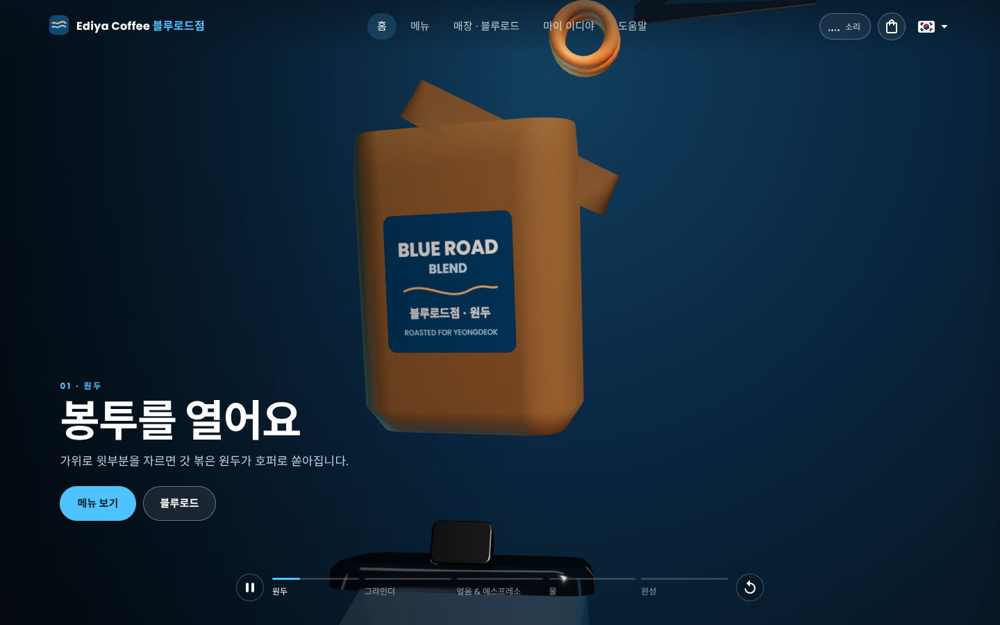
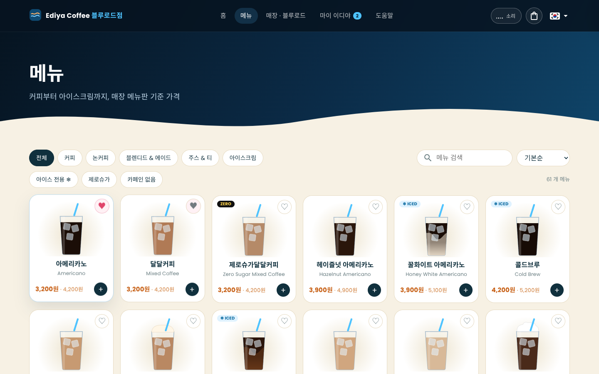
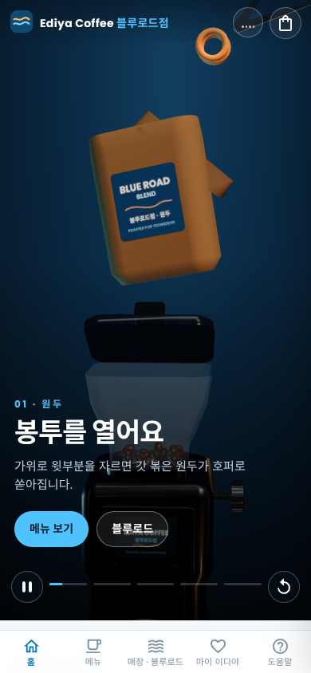
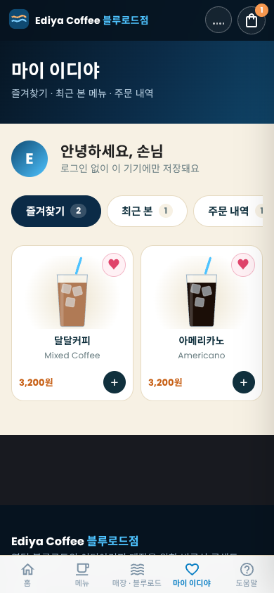

<div align="center">

# Ediya BlueRoad

**A coffee-shop website that helps non-Korean speakers order at the counter, with a real-time 3D drink story on the home page.**

[Live demo](https://YOUR-VERCEL-URL.vercel.app) · [한국어](./README.ko.md)




</div>

> **Unofficial concept project.** Built by a barista at an Ediya Coffee store in Yeongdeok, South Korea, as a portfolio piece. It is not the official Ediya website and has no ordering or payment.

## The problem
Visitors to a small coastal town often don't speak much Korean. Standing at a café counter, they know what they want but not how to say it, and a menu board doesn't help.

## The solution
Browse the real menu on your phone, add drinks to a cart, and the cart turns into a sentence you can read out or show at the counter:

> **아이스 아메리카노 라지 2잔 주문할게요.**
> *(Two large iced Americanos, please.)*

The home page tells the story of one drink (bag → grinder → ice → espresso → water → finished glass) as a 3D animation that plays by itself, with an optional sound track.

## Screenshots

| Menu (desktop) | Home (mobile) | My Ediya (mobile) |
|---|---|---|
|  |  |  |

## Features
- **Autoplay 3D hero** built with three.js: a bag and scissors, a grinder with a live dose screen, ice, espresso and water, ending on a glass with a frosted logo. Pause, replay and five stage chips; no scrolling needed.
- **Optional hero video**: add a generated video and it replaces the 3D scene, with the 3D animation kept as the fallback (see [Using a hero video](#using-a-hero-video)).
- **Sound**: procedural WebAudio (sea and café ambience, plus grinder, pour and clink sounds that follow the animation). Silent until you press the button.
- **Menu**: 61 drinks with category chips, filters (iced-only, zero sugar, caffeine-free), sorting and search.
- **Drink detail**: a draggable 3D glass, size / temperature / options, taste bars and related drinks.
- **Cart → order phrase**: copy the Korean sentence for the counter.
- **My Ediya**: favourites, recently viewed, order history and a nickname. No account needed; everything stays in the browser.
- **Help centre**, a **store and Blue Road** page with an SVG course map, and a custom 404.
- **Korean (default), English and Russian**, with separate desktop and mobile layouts (bottom tab bar on phones).

## Tech stack
| Area | Choice |
|---|---|
| Framework | Next.js 14 (Pages Router), React 18, TypeScript 5 |
| UI | MUI 5 + SCSS (one brand stylesheet: `scss/ediya.scss`) |
| 3D | three.js 0.150: custom lofted geometry, instanced meshes, a generated environment map and canvas textures |
| Audio | Web Audio API: synthesised noise, filters and envelopes (no audio files) |
| State | Apollo Client reactive variables, persisted to `localStorage` |
| i18n | next-i18next (kr / en / ru) |
| Hosting | Vercel (static pages, no server) |

## How it works
- **Time-driven animation.** The hero is a single progress value `p` from 0 to 1 advanced by a clock; every stage (bag, grinder, pour, water) is a function of `p`. That is why it can autoplay, pause, replay and jump between stages. The stage captions use the same `p`, so the video mode reuses them.
- **Light first load.** three.js is loaded with a dynamic import, so pages that don't need it (menu, help) stay small. The home page's first-load JavaScript stays under 200 kB.
- **Sound without pops.** The audio context starts only on a click, and every gain change is ramped. Sound is paused when the hero scrolls out of view.
- **No backend.** Menu data is a typed file, and favourites, history and cart live in `localStorage`. The site deploys as static pages.

## Getting started
```bash
git clone https://github.com/mipuxen/Ediya-Coffe-Demo.git
cd Ediya-Coffe-Demo
yarn install
yarn dev            # http://localhost:3000
```
Production build: `yarn build && yarn start`. No environment variables are needed.

**Deploy:** import the repository in [Vercel](https://vercel.com) (preset: Next.js) and every `git push` redeploys.

## Using a hero video
Put the files in `public/video/` and push. The home hero uses the video automatically, and falls back to the 3D animation when no file exists.

| File | Ratio | Used on |
|---|---|---|
| `story-wide.mp4` | 16:9 | Desktop and tablet |
| `story-vertical.mp4` | 9:16 | Phones |

Either file alone is enough. The captions and stage chips follow the video's timeline (bag 0%, grinder 22%, ice and espresso 50%, water 70%, finished glass 88%; adjustable via `STAGES` in `libs/ediya/constants.ts`). Use H.264 without audio, a 10 to 16 second loop under about 5 MB:
```bash
ffmpeg -i input.mp4 -an -c:v libx264 -crf 26 -preset slow -pix_fmt yuv420p -movflags +faststart story-wide.mp4
```

## Project structure
```
pages/                  index, menu, menu/detail, store, mypage, cs, 404
libs/ediya/             heroScene.ts (3D story), glassViewer.ts (drink glass), kit.ts (3D helpers),
                        sound.ts (WebAudio), cart.ts (cart + order phrase), me.ts (favourites, history)
libs/components/ediya/  hero, cart drawer, drink card, map, My Ediya, Help
libs/data/              menu.ts (61 drinks), help.ts
scss/ediya.scss         brand layer
public/locales/         kr, en, ru translations
```

## Roadmap
- [ ] Store address, hours and phone (the section is hidden until filled in)
- [ ] Real hero video from the generated animation
- [ ] NestJS + database API for accounts and a community board

## Notes and limits
- Taste descriptions are general introductions, not the real recipes. Prices follow the in-store menu board and may change.
- The project started from the open-source Nestar Next.js template. Its real-estate and backend features were removed; about 18% of the code (layout wrappers, theme and i18n setup) is still from the template.

## Author
**Khoshimov Shukhratbek**: [GitHub @mipuxen](https://github.com/mipuxen)
